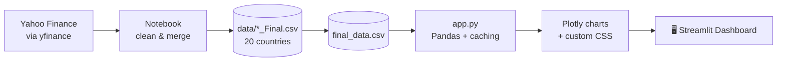
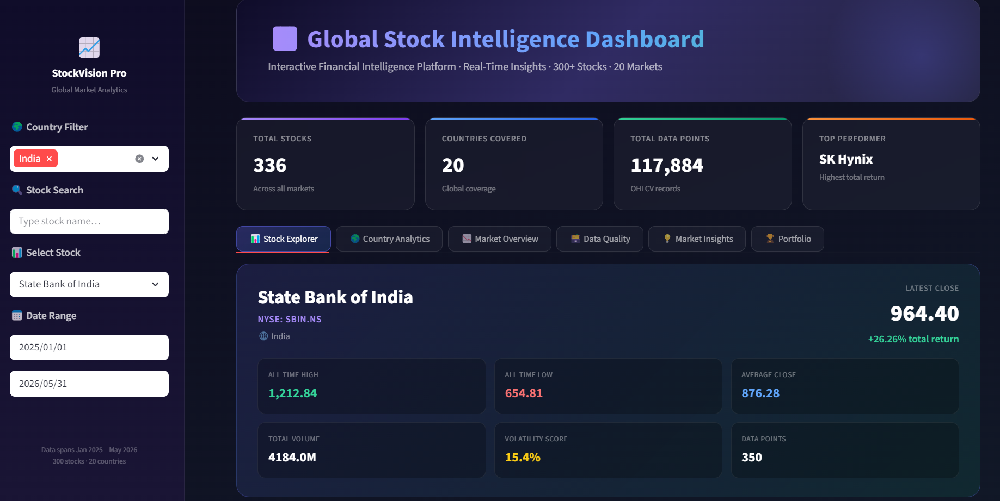
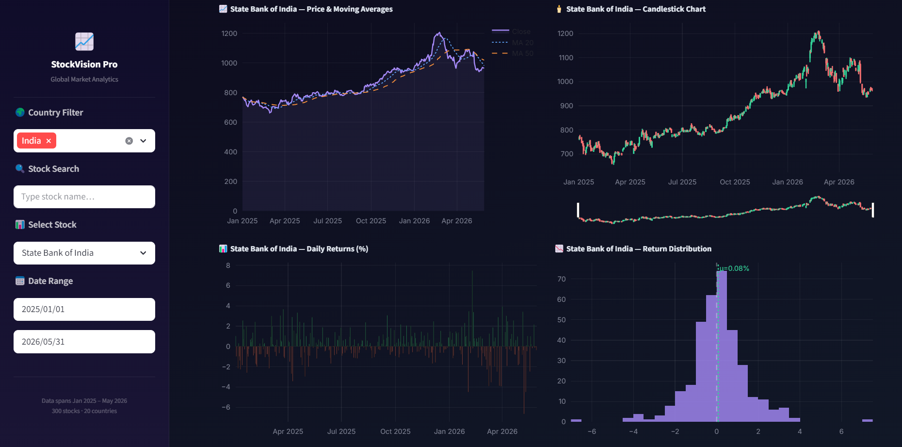
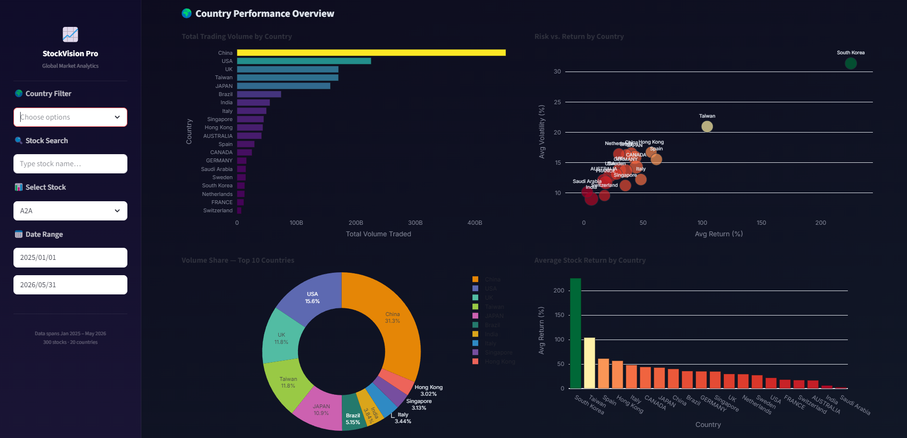
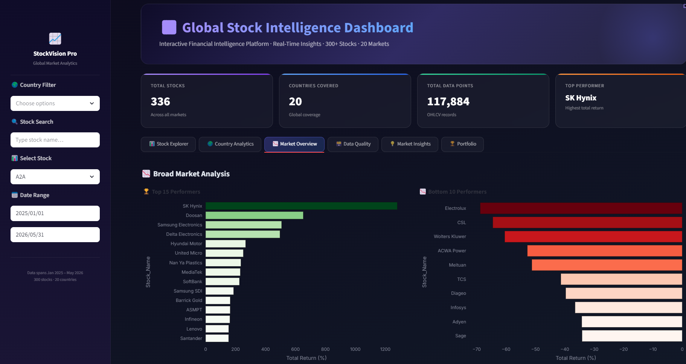

<div align="center">

# 📈 Global Stock Intelligence Dashboard

### Explore 336 stocks across 20 countries in one interactive, dark-themed analytics app

[](https://global-stock-intelligence-dashboard-grw8avhbjh5cvgc6sjqya3.streamlit.app/)
[](https://github.com/vedant150705/Global-Stock-Intelligence-Dashboard)


</div>

---

## 🌍 Overview

Market data is huge and scattered across exchanges. This dashboard brings **daily OHLCV data from 20 global markets** into a single app so you can quickly see **who is winning, who is risky, where money is trading, and how stocks move together.**

> 💡 Pick a country → pick a stock → get price trends, candlesticks, returns, volatility and auto-generated insights in seconds.

---

## 📊 At a Glance

| 📈 Stocks | 🌐 Countries | 🗂️ Records | 📅 Period | ✅ Missing Values |
|:---:|:---:|:---:|:---:|:---:|
| **336** | **20** | **117,884** | **Jan 2025 → May 2026** | **0** |

---

## ✨ Features

The app has **6 tabs**:

| Tab | What you get |
|---|---|
| 📊 **Stock Explorer** | Stock profile card (latest close, high/low, avg, volume, volatility), price with **MA20 / MA50**, **candlestick** chart, daily returns, return distribution, volume with 20-day average |
| 🌍 **Country Analytics** | Trading volume by country, **risk vs. return** bubble chart, volume share donut, average return per country, summary table |
| 📉 **Market Overview** | **Top 15 / Bottom 10** performers, risk-vs-return map for all stocks, **correlation heatmap** of the 20 most traded stocks |
| 🗃️ **Data Quality** | Quality score, completeness and uniqueness gauges, schema viewer, live data preview |
| 💡 **Market Insights** | 12 auto-generated insights (best/worst stock, most stable, most volatile, top market, sector comparison) plus a bullish/bearish summary |
| 🏆 **Portfolio** | Skills demonstrated, tech stack and dataset scope |

**Sidebar controls:** country multi-select · stock search · stock selector · date range.

---

## 🧮 How the Numbers Are Calculated

| Metric | Formula |
|---|---|
| **Daily Return** | `% change of Close` per stock |
| **MA20 / MA50** | 20 / 50-day rolling mean of Close |
| **Total Return** | `(Latest Close − First Close) / First Close × 100` |
| **Volatility Score** | `Std Dev of Close / Mean Close × 100` |
| **Country Stats** | Average return, volatility and total volume across its stocks |

---

## 🏗️ How It Works



---

## 🌎 Markets Covered

🇺🇸 USA · 🇮🇳 India · 🇬🇧 UK · 🇨🇦 Canada · 🇯🇵 Japan · 🇩🇪 Germany · 🇫🇷 France · 🇨🇳 China · 🇭🇰 Hong Kong · 🇸🇬 Singapore · 🇰🇷 South Korea · 🇸🇦 Saudi Arabia · 🇦🇺 Australia · 🇧🇷 Brazil · 🇹🇼 Taiwan · 🇳🇱 Netherlands · 🇨🇭 Switzerland · 🇸🇪 Sweden · 🇮🇹 Italy · 🇪🇸 Spain

---

## 📸 Screenshots

| Stock Explorer | Stock Analytics |
|:---:|:---:|
|  |  |

| Country Analytics | Market Overview |
|:---:|:---:|
|  |  |

---

## 🛠️ Tech Stack

| Tool | Used for |
|---|---|
| **Python** | Core language |
| **Pandas · NumPy** | Data cleaning, returns, rolling metrics |
| **Streamlit** | Web app and layout |
| **Plotly** | Interactive charts (candlestick, heatmap, bubble, donut) |
| **yfinance** | Data collection from Yahoo Finance |
| **Jupyter** | Data collection and EDA |
| **CSS** | Glassmorphism dark theme, KPI cards |

---

## 📂 Project Structure

```text
Global-Stock-Intelligence-Dashboard/
├── app.py                  # Streamlit dashboard
├── final_data.csv          # Combined dataset (all countries)
├── data/                   # 20 country-wise CSVs
├── notebook/stocks.ipynb   # Data collection & EDA
├── screenshots/            # README images
├── requirements.txt
└── LICENSE
```

**Data columns:** `Date · Open · High · Low · Close · Volume · Stock_Name · Ticker · Country`

---

## ⚙️ Run Locally

```bash
# 1. Clone
git clone https://github.com/vedant150705/Global-Stock-Intelligence-Dashboard.git
cd Global-Stock-Intelligence-Dashboard

# 2. Install
pip install -r requirements.txt

# 3. Launch
python -m streamlit run app.py
```

Then open **http://localhost:8501** 🎉

---

## 🔮 Roadmap

- [ ] Sharpe ratio and drawdown risk metrics
- [ ] Price forecasting models
- [ ] News sentiment analysis
- [ ] Live data refresh and price alerts

---

## ⚠️ Disclaimer

This project is for **education and analytics only**. It is not financial advice.

---

<div align="center">

**If this project helped you, please ⭐ the repo!**

Made with ❤️ using Python, Streamlit & Plotly

</div>
